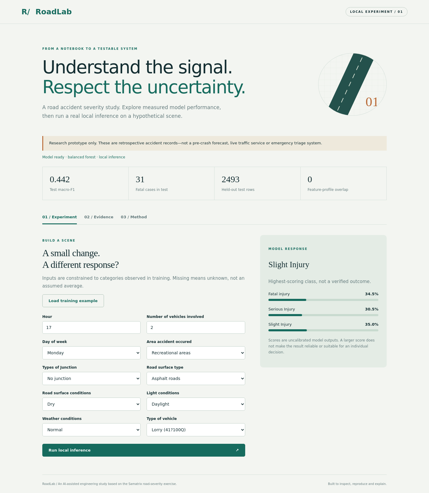
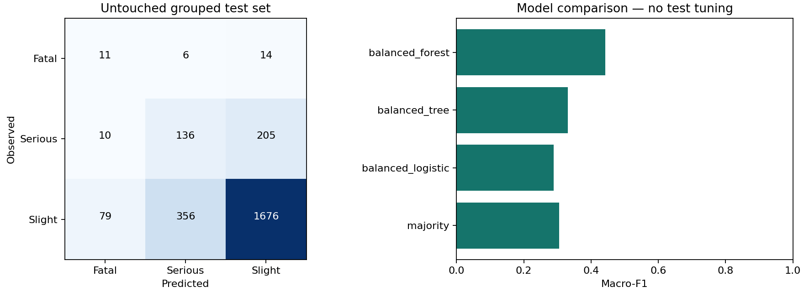

# RoadLab · Road Accident Severity

A reproducible machine-learning experiment with a working local web interface and a validated FastAPI service. Developed as an AI-assisted third-year computer-science engineering study, expanding the Samatrix road-accident exercise into a testable software project. This is not an MIT-endorsed project or a claim of unaided student authorship.



## What makes this more than a notebook

- A shared feature contract for training and inference; ten interpretable scene/vehicle inputs rather than casualty outcomes.
- Grouped train/validation/test splits keep identical input profiles together. Learned preprocessing is fitted only on training data.
- Majority baseline and three balanced classifiers, selected by validation macro-F1, not test accuracy.
- Per-class recall, confusion matrices, balanced accuracy, validation permutation importance and a validation-only fatal-miss audit; row- and profile-cluster bootstrap intervals.
- Grouped out-of-fold fatal-score cutoff exploration shows fatal-recall/false-alarm trade-offs without choosing a cutoff or touching the test holdout.
- Real local single/batch inference, strict input validation, OpenAPI documentation, responsive UI, automated tests and GitHub Actions.
- Dataset hash checks, exact dependency versions, saved experiment metadata, model card and reproducible training command.

## Quick start · Python 3.11

```sh
python -m venv .venv
# macOS/Linux
source .venv/bin/activate
# Windows PowerShell: .venv\Scripts\Activate.ps1
pip install -r requirements-dev.txt
python -m roadlab.train
python -m pytest -q
ruff check roadlab tests
uvicorn roadlab.api:app --host 127.0.0.1 --port 8000
```

Open **http://127.0.0.1:8000** for the interface, or **http://127.0.0.1:8000/docs** for the API. Training downloads the reviewed public CSV mirror if missing, then verifies its SHA-256 before use. Raw data and serialized model are not committed. Training takes approximately a minute on the development machine; actual time varies. The ZIP release includes a trained model for convenience; only load joblib files you trust.

For the optional notebook, install `pip install -r requirements-notebook.txt`, then run `jupyter lab` and open `RoadLab.ipynb` from the repository root. Its cells call the same tested code rather than maintaining a second training implementation. It is supplied unexecuted; measured outputs are in `artifacts/metrics.json`.

## Measured result

One fixed grouped experiment selected a balanced random forest:

| Candidate | Validation macro-F1 | Test macro-F1 | Test accuracy |
|---|---:|---:|---:|
| Majority class | 0.305 | 0.306 | 84.7% |
| Balanced logistic regression | 0.280 | 0.289 | 42.7% |
| Balanced decision tree | 0.339 | 0.331 | 52.8% |
| Balanced random forest | 0.408 | 0.442 | 73.1% |

A separate five-fold `StratifiedGroupKFold` compares candidates using only the 9,823 development rows (127 fatal-labelled rows). Folds keep identical ten-feature input profiles together; the 2,493-row final test holdout is excluded from every CV fit and score.

| Candidate | OOF fatal recall | Fatal rows caught | OOF macro-F1 |
|---|---:|---:|---:|
| Majority baseline | 0.0% | 0/127 | 0.305 |
| Balanced logistic regression | 49.6% | 63/127 | 0.282 |
| Balanced decision tree | 45.7% | 58/127 | 0.365 |
| Balanced random forest | 21.3% | 27/127 | 0.425 |

The forest leads on macro-F1, while logistic regression catches the most fatal rows; that is the clearest trade-off in this comparison. It remains exploratory because the earlier validation split selected the current model. Identical input profiles are not incident IDs, so the grouping cannot rule out the same real accident appearing across folds.

The selected model's test recall is **35.5% fatal**, **38.7% serious** and **79.4% slight**. It misses most fatal cases. Its macro-F1 95% intervals are **0.412–0.474** under stratified row resampling and **0.411–0.473** under a profile-cluster sensitivity bootstrap (300 resamples of 2,258 test profiles; none omitted a class). The clusters are identical input profiles, not known incident IDs, so this still cannot quantify incident-level, temporal/geographic or model-selection uncertainty. The majority baseline's apparently strong accuracy is exactly why accuracy alone is misleading. The selected model correctly classified **3 of 33 fatal-labelled validation rows** and missed 30 (19 predicted slight, 11 serious). Because this same split selected the model, the audit is exploratory—not an independent performance estimate—and exposes only aggregate counts.

These results are not directly comparable with the earlier study implementation: the input set, grouping rule and holdout changed. The engineering upgrade is not a claim that accuracy universally improved.



## API example

```python
import requests
base = 'http://127.0.0.1:8000'
example = requests.get(base + '/api/metadata').json()['examples'][0]
response = requests.post(base + '/api/predict', json={'records': [example]})
response.raise_for_status()
print(response.json())
```

`POST /api/predict` accepts 1–100 records. Every feature must be present; use `null` for unknown values. Unknown categories, invalid numeric ranges and extra fields are rejected. Responses contain a predicted class and uncalibrated class scores, not a clinically or operationally reliable risk estimate. No input is persisted by application code. The service deliberately binds to localhost in the documented command; it has no authentication and must not be exposed directly to the internet.

## Structure

```text
roadlab/core.py     feature contract and input validation
roadlab/train.py    dataset integrity, grouped experiment, metrics and artifacts
roadlab/api.py      local inference and metadata API
web/               responsive, live model interface
artifacts/         measured metrics, schema, training examples and charts
RoadLab.ipynb      guided reproducible experiment
tests/            contract, inference, failure and split-audit tests
docs/             model card, design notes and learning guide
```

## Data, scope and attribution

The supplied Samatrix material describes Addis Ababa police accident records from 2017–2020 and links to the [public CSV mirror](https://github.com/avikumart/Road-Traffic-Severity-Classification-Project/blob/main/RTA%20Dataset.csv). This repository independently implements the educational task; it does not redistribute Samatrix's proprietary submission sheet, course notebook or class roster. The mirror's original provenance and redistribution terms are not established here, so the dataset is downloaded separately rather than bundled or relicensed. See [data notes](docs/DATA.md).

Read the [model card](docs/MODEL-CARD.md), [design decisions](docs/DESIGN.md), and [learning guide](docs/LEARNING.md) before interpreting the demo. This is retrospective classification of an already-recorded accident, not prediction of a crash, pre-crash severity forecasting, a production service or emergency triage. No independent temporal, geographic or prospective evaluation has been performed.

Built with Wabi assistance. Review, rerun and understand the implementation before presenting it; explain your own changes honestly and follow your institution's AI-use rules.
